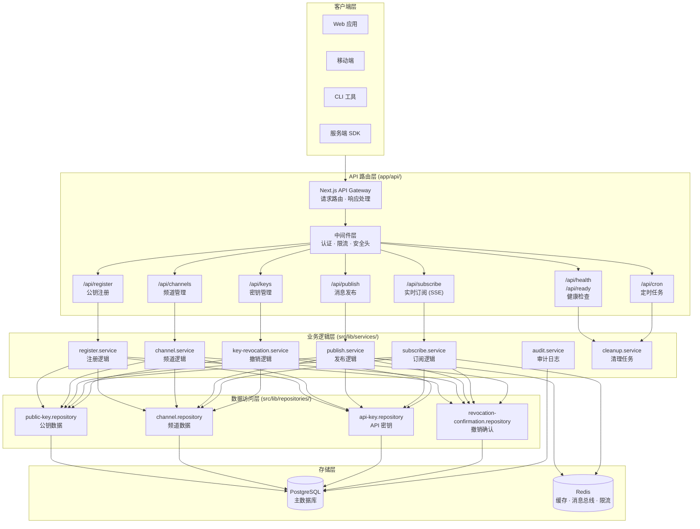
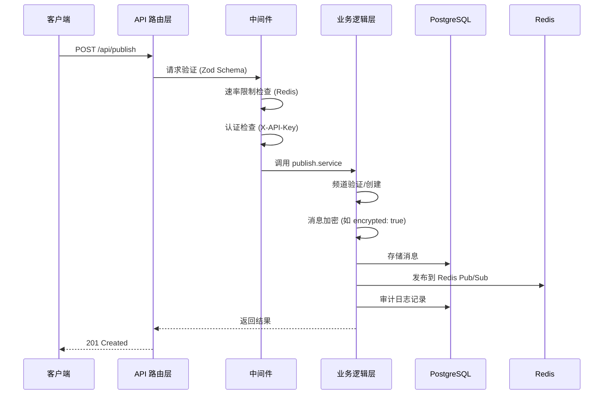
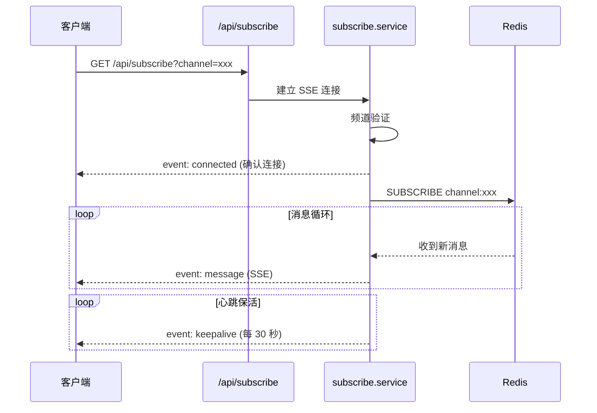
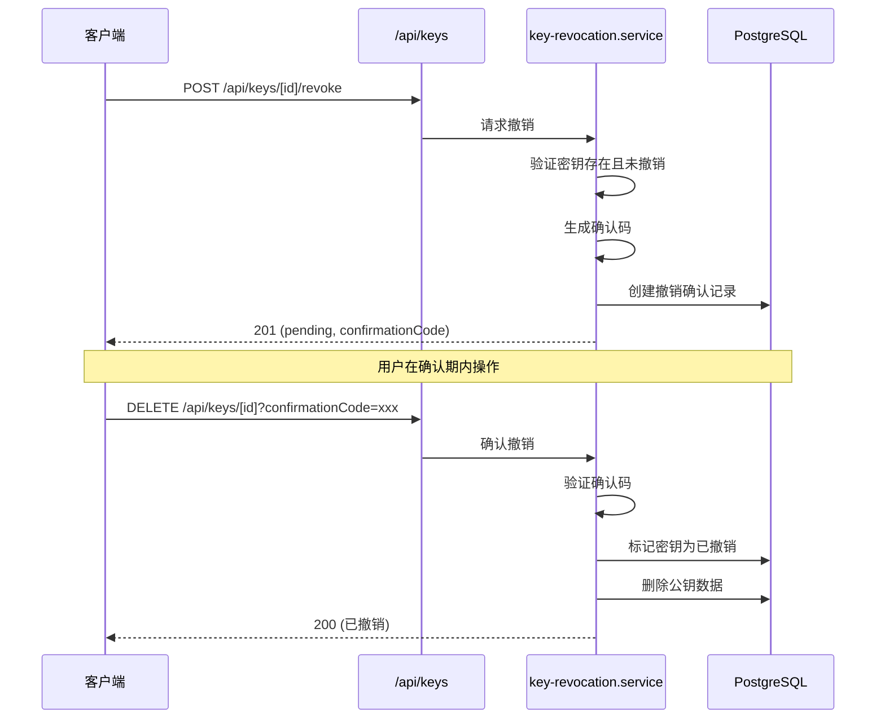
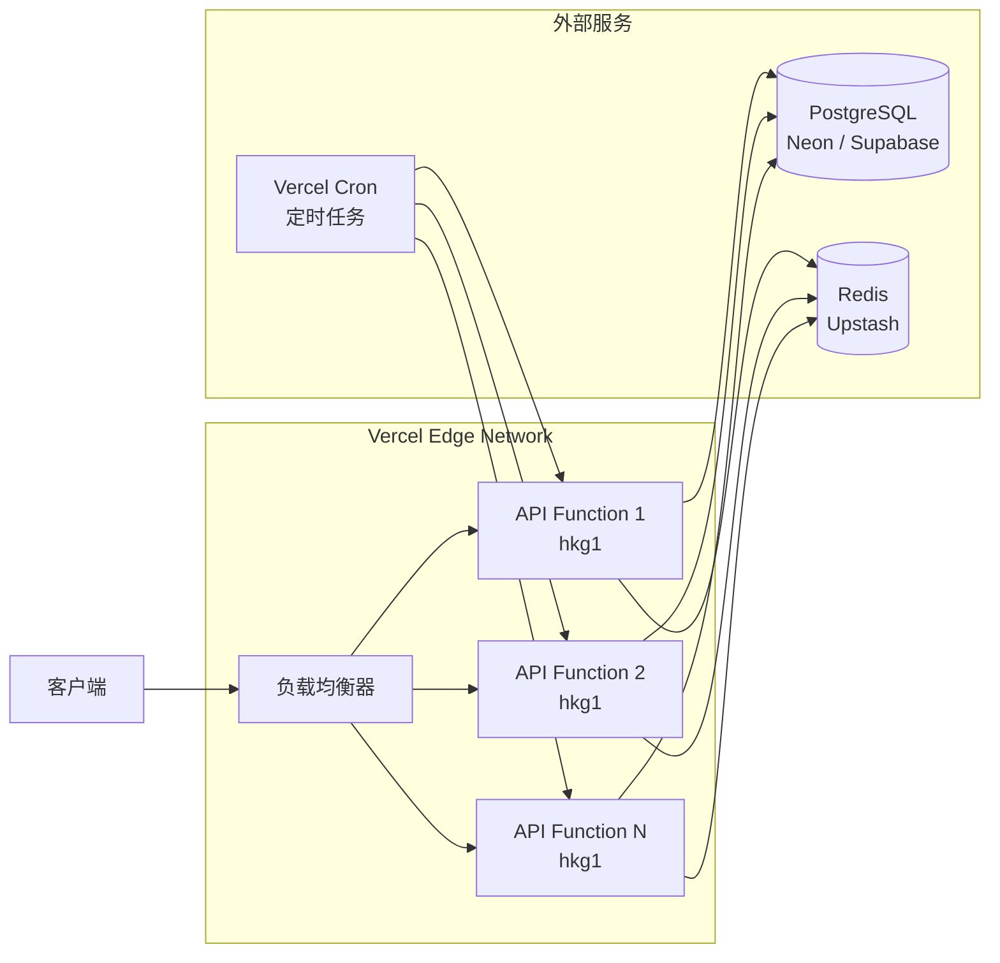

# 🏗️ SecureNotify 架构文档

SecureNotify 是一个生产就绪的加密推送通知服务，采用 Next.js 16 App Router 构建，以 API 路由层 → 业务逻辑层 → 数据访问层的三层架构组织代码，中间件统一处理认证、限流、日志等横切关注点。本文档基于 `src/`、`app/api/` 实际代码结构，介绍设计原则、模块划分、数据流以及安全与性能设计。

## 📋 目录

- [概述](#-概述)
- [设计原则](#-设计原则)
- [系统架构](#️-系统架构)
- [模块划分](#-模块划分)
- [数据流](#-数据流)
- [安全设计](#-安全设计)
- [性能设计](#-性能设计)
- [部署架构](#-部署架构)
- [相关文档](#-相关文档)

---

## 🎯 概述

SecureNotify 解决的核心问题是：如何让应用程序以安全、实时、可靠的方式推送加密消息。它的能力边界由功能模块精确控制：从最小的公钥注册与查询，到覆盖实时订阅、两阶段撤销与审计日志的完整能力。

核心能力一览：

- **公钥管理**：支持 RSA-2048、RSA-4096、ECC-SECP256K1 多种算法的公钥注册、查询与两阶段撤销。
- **实时消息分发**：基于 Server-Sent Events (SSE) 的实时推送，配合 Redis Pub/Sub 实现多实例消息同步。
- **端到端加密**：混合加密架构（RSA + AES-256-GCM），消息内容加密存储与传输。
- **多层安全防护**：API 密钥认证、请求限流、审计日志、输入验证、安全响应头。
- **优先级队列**：五级消息优先级（CRITICAL/HIGH/NORMAL/LOW/BULK），确保重要消息优先处理。

---

## 📐 设计原则

1. **分层解耦**：API 路由层（`app/api/`）只负责请求/响应处理，业务逻辑层（`src/lib/services/`）负责核心逻辑，数据访问层（`src/lib/repositories/`）负责持久化，三层职责清晰。
2. **中间件统一治理**：认证（`api-key.ts`）、限流（`rate-limit.ts`）、错误处理（`error-handler.ts`）、安全头（`security.config.ts`）等横切关注点由中间件统一处理，避免重复代码。
3. **类型安全**：使用 Zod 进行运行时输入验证，TypeScript 严格类型约束编译期类型安全。
4. **失败快速**：使用自定义错误类型（`error.utils.ts`）与服务错误映射（`service-error-mapper.ts`），在边界处快速失败并返回明确错误信息。
5. **无状态设计**：API 服务无状态，会话数据存储在 Redis，支持水平扩展。
6. **安全默认**：所有 API 端点默认需要认证（除健康检查），安全响应头默认启用。

---

## 🏛️ 系统架构

整体分为四层：客户端 → API 路由层 → 业务逻辑层 → 数据访问层，Redis 作为消息总线与缓存，PostgreSQL 作为主数据库。



对应的仓库物理布局：

```text
subno.ts/
├── app/
│   ├── api/                    # API 路由层
│   │   ├── register/           # 公钥注册
│   │   ├── channels/           # 频道管理
│   │   ├── publish/            # 消息发布
│   │   ├── subscribe/          # 实时订阅 (SSE)
│   │   ├── keys/               # 密钥管理与撤销
│   │   ├── health/             # 存活检查
│   │   ├── ready/              # 就绪检查
│   │   └── cron/               # 定时任务
│   ├── components/             # React 组件
│   └── api-docs/               # API 文档页面
├── src/
│   ├── config/                 # 配置（CORS、数据库、限流、安全）
│   ├── db/                     # 数据库 schema 与连接
│   └── lib/
│       ├── services/           # 业务逻辑层
│       ├── repositories/       # 数据访问层
│       ├── middleware/         # 中间件（认证、限流）
│       ├── enums/              # 枚举定义
│       ├── types/              # 类型定义
│       └── utils/              # 工具函数
├── sdk/                        # 多语言 SDK
├── __tests__/                  # 测试文件
└── docker/                     # Docker 部署配置
```

---

## 🧩 模块划分

### API 路由层（`app/api/`）

| 路由                           | 职责                 | 关键依赖                          |
| ------------------------------ | -------------------- | --------------------------------- |
| `/api/register`                | 公钥注册与查询       | `register.service`                |
| `/api/channels`                | 频道创建与查询       | `channel.service`                 |
| `/api/publish`                 | 消息发布与队列状态   | `publish.service`                 |
| `/api/subscribe`               | 实时消息订阅（SSE）  | `subscribe.service`               |
| `/api/keys/[id]`               | 密钥查询与删除       | `key-revocation.service`          |
| `/api/keys/[id]/revoke`        | 密钥撤销请求与查询   | `key-revocation.service`          |
| `/api/keys/[id]/revoke/cancel` | 取消撤销请求         | `key-revocation.service`          |
| `/api/health`                  | 存活检查             | 无                                |
| `/api/ready`                   | 就绪检查（DB/Redis） | `database.config`、`redis-client` |
| `/api/cron/cleanup-channels`   | 频道清理             | `cleanup.service`                 |
| `/api/cron/cleanup-keys`       | 密钥清理             | `cleanup.service`                 |

### 业务逻辑层（`src/lib/services/`）

| 模块                     | 职责                                 | 关键类型                                |
| ------------------------ | ------------------------------------ | --------------------------------------- |
| `register.service`       | 公钥注册、验证、自动创建加密频道     | `RegisterRequest`、`RegisterResponse`   |
| `channel.service`        | 频道创建、查询、验证、自动过期       | `ChannelType`、`Channel`                |
| `publish.service`        | 消息发布、加密、优先级排序、队列管理 | `MessagePriority`、`PublishResult`      |
| `subscribe.service`      | SSE 连接管理、消息分发、心跳保活     | `SubscribeEvent`、`SSEConnection`       |
| `key-revocation.service` | 两阶段撤销、确认码生成、过期处理     | `RevocationStatus`、`RevocationRequest` |
| `audit.service`          | 操作审计日志记录与查询               | `AuditLogEntry`                         |
| `cleanup.service`        | 过期频道/密钥清理、数据归档          | `CleanupResult`                         |

### 数据访问层（`src/lib/repositories/`）

| 模块                                 | 职责                              | 数据表                     |
| ------------------------------------ | --------------------------------- | -------------------------- |
| `public-key.repository`              | 公钥 CRUD、过期查询、撤销状态更新 | `public_keys`              |
| `channel.repository`                 | 频道 CRUD、过期查询、活跃状态管理 | `channels`                 |
| `api-key.repository`                 | API 密钥 CRUD、权限验证           | `api_keys`                 |
| `revocation-confirmation.repository` | 撤销确认码 CRUD、过期处理         | `revocation_confirmations` |
| `query-builder`                      | 通用查询构建、分页、过滤          | -                          |

### 中间件层（`src/lib/middleware/`）

| 模块            | 职责                      | 配置               |
| --------------- | ------------------------- | ------------------ |
| `api-key.ts`    | API 密钥认证与权限验证    | `X-API-Key` header |
| `rate-limit.ts` | IP 与 User-Agent 双重限流 | Redis 计数器       |

### 配置层（`src/lib/config/`）

| 模块                   | 职责                  |
| ---------------------- | --------------------- |
| `cors.config.ts`       | CORS 跨域配置         |
| `database.config.ts`   | PostgreSQL 连接池配置 |
| `rate-limit.config.ts` | 限流阈值与窗口配置    |
| `security.config.ts`   | 安全响应头配置        |
| `env.ts`               | 环境变量加载与验证    |

---

## 🌊 数据流

### 消息发布主流程



### 实时订阅流程



### 两阶段密钥撤销流程



---

## 🔒 安全设计

安全设计围绕"消息全生命周期防护"展开：

1. **传输加密**：全站 HTTPS/TLS 1.3，Vercel 边缘网络自动处理证书。
2. **应用层加密**：混合加密架构（RSA + AES-256-GCM），消息内容加密存储，仅接收者可解密。
3. **密钥管理**：公钥过期自动清理，两阶段撤销防止误操作，API 密钥支持权限分级。
4. **访问控制**：所有 API 端点（除健康检查）需要 `X-API-Key` 认证，权限分为 `read`/`write`/`admin`。
5. **请求限流**：IP 与 User-Agent 双重限流，防止暴力破解与 DDoS。
6. **输入验证**：使用 Zod Schema 对所有输入进行严格验证，防止注入攻击。
7. **安全响应头**：`X-Content-Type-Options: nosniff`、`X-Frame-Options: DENY`、`Referrer-Policy: origin-when-cross-origin`。
8. **审计追踪**：所有关键操作记录审计日志，支持事后追溯。

---

## ⚡ 性能设计

性能设计目标：消息读取路径低延迟，推送路径实时可靠。

1. **缓存策略**：公钥查询使用 Redis Cache-Aside 模式，TTL 7 天，减少数据库查询。
2. **连接池**：PostgreSQL 连接池管理，避免连接耗尽。
3. **Redis Pub/Sub**：消息发布后立即推送到 Redis，订阅者实时消费，无需轮询。
4. **SSE 长连接**：相比 WebSocket 更轻量，自动重连，适合服务端到客户端的单向推送。
5. **优先级队列**：高优先级消息优先处理，确保关键消息及时送达。
6. **无状态设计**：API 服务无状态，支持水平扩展，负载均衡器分发请求。
7. **数据库优化**：索引优化查询性能，批量操作减少往返次数。

---

## 🚀 部署架构

### Vercel 部署（推荐）



- **区域**：`hkg1`（香港），优化亚太区延迟
- **Cron 任务**：`cleanup-channels`（每天 02:00）、`cleanup-keys`（每天 03:30）
- **部署后冒烟测试**：GitHub Actions `Deploy` 工作流自动执行 10 项接口测试

### Docker 部署

详见 [Docker 部署文档](../docker/DEPLOYMENT.md)。

---

## 📚 相关文档

| 文档                            | 说明                       |
| ------------------------------- | -------------------------- |
| [📖 用户指南](USER_GUIDE.md)    | 面向使用者的功能与最佳实践 |
| [📘 API 参考](API_REFERENCE.md) | 各 API 端点的完整签名      |
| [📈 性能指南](PERFORMANCE.md)   | 性能设计与基准数据         |
| [🔒 安全文档](SECURITY.md)      | 安全架构与最佳实践         |
| [❓ FAQ](FAQ.md)                | 常见问题解答               |
