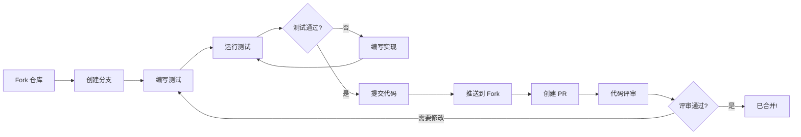
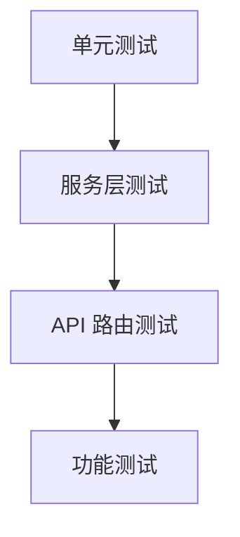

# 🤝 SecureNotify 贡献指南

感谢您关注 **SecureNotify**！无论您是在修复缺陷、添加新特性、改进文档还是帮助他人，您的贡献都弥足珍贵。

## 📋 目录

- [欢迎](#-欢迎)
- [环境准备](#-环境准备)
- [开发工作流](#-开发工作流)
- [代码规范](#-代码规范)
- [提交与 PR 流程](#-提交与-pr-流程)
- [行为准则](#-行为准则)

---

## 👋 欢迎

欢迎参与 **SecureNotify** 的建设！

**贡献方式：**

| 代码               | 文档           | 测试               | 社区           |
| :----------------- | :------------- | :----------------- | :------------- |
| 修复缺陷、添加特性 | 改进文档与指南 | 编写测试、发现问题 | 帮助与支持他人 |

---

## 🧰 环境准备

### 前置条件

开始之前，请确认已安装：

- **Git** - 版本控制工具
- **Node.js 22.0.0+** - 运行时环境
- **npm** - 包管理器（随 Node.js 安装）
- **PostgreSQL 14+** - 数据库（或使用 Docker）
- **Redis 7+** - 缓存/消息总线（或使用 Docker）
- **IDE** - VS Code（推荐）、WebStorm 或同类工具

### Fork 与 Clone

|         步骤         | 操作                                                           |
| :------------------: | :------------------------------------------------------------- |
|   **1. Fork 仓库**   | 在 GitHub 上点击 "Fork" 按钮                                   |
|     **2. Clone**     | `git clone https://github.com/YOUR_USERNAME/subno.ts`          |
| **3. 添加 upstream** | `git remote add upstream https://github.com/your-org/subno.ts` |
|     **4. 验证**      | `git remote -v`                                                |

### 安装依赖

```bash
# 安装依赖
npm install

# 配置环境变量
cp .env.example .env
# 编辑 .env 文件，填入本地数据库与 Redis 连接信息

# 运行数据库迁移
npm run db:migrate

# 验证安装
npm run build
```

### Git 钩子（Husky）

仓库使用 [Husky](https://typicode.github.io/husky/) 执行本地质量门禁：

| 钩子       | 检查项                                |
| :--------- | :------------------------------------ |
| pre-commit | ESLint + Prettier（通过 lint-staged） |
| commit-msg | Conventional Commits 格式校验         |

### 构建与测试

```bash
# 构建项目
npm run build

# 运行全部测试
npm test

# 生成覆盖率报告
npm run test:coverage

# 代码检查
npm run lint

# 类型检查
npx tsc --noEmit
```

---

## 🔄 开发工作流

本项目采用测试驱动开发（TDD）：先写测试，再写实现，用测试驱动代码演进。



### 详细步骤

#### 1️⃣ 创建分支

分支应基于 `main` 分支创建。

```bash
# 同步 upstream 的 main 分支
git fetch upstream
git checkout main
git merge upstream/main

# 创建特性分支
git checkout -b feature/TICKET-ID-description

# 或创建缺陷修复分支
git checkout -b bugfix/TICKET-ID-description
```

**分支命名规范：**

| 类型     | 前缀         | 示例                       |
| :------- | :----------- | :------------------------- |
| 新特性   | `feature/*`  | `feature/add-encryption`   |
| 缺陷修复 | `bugfix/*`   | `bugfix/fix-memory-leak`   |
| 紧急修复 | `hotfix/*`   | `hotfix/critical-security` |
| 发布     | `release/*`  | `release/v1.0.0`           |
| 重构     | `refactor/*` | `refactor/improve-perf`    |
| 文档     | `docs/*`     | `docs/update-readme`       |

#### 2️⃣ 编写测试并运行静态检查

提交之前，确保代码通过全部本地检查。

```bash
# 格式化代码
npx prettier --write .

# 运行 ESLint 静态分析
npm run lint

# 运行全部测试
npm test

# 类型检查
npx tsc --noEmit
```

#### 3️⃣ 提交代码

我们遵循 [Conventional Commits](https://www.conventionalcommits.org/) 规范。

**提交格式：**
`<type>(<scope>): <subject>`

**常用类型：**

| 类型       | 说明     | 示例                                   |
| :--------- | :------- | :------------------------------------- |
| `feat`     | 新特性   | `feat(auth): add API key rotation`     |
| `fix`      | 缺陷修复 | `fix(publish): resolve race condition` |
| `docs`     | 文档变更 | `docs: update README`                  |
| `style`    | 代码格式 | `style: format code`                   |
| `refactor` | 代码重构 | `refactor: improve error handling`     |
| `perf`     | 性能优化 | `perf: optimize cache strategy`        |
| `test`     | 测试相关 | `test: add unit tests for crypto`      |
| `chore`    | 构建工具 | `chore: update dependencies`           |

**示例：**

```bash
git commit -m "feat(auth): add API key rotation mechanism"
```

#### 4️⃣ 合并与清理（强制）

完成开发或缺陷修复后，**必须**按以下强制流程合并回主分支并清理：

**第 1 步：合并前质量检查**

```bash
# 运行全部测试
npm test

# 类型检查
npx tsc --noEmit

# 代码检查
npm run lint
```

**全部检查通过后才能进行合并。**

**第 2 步：合并到 main 分支**

```bash
# 切换到 main 分支
git checkout main

# 与 upstream 同步
git fetch upstream
git merge upstream/main

# 合并你的 feature/bugfix 分支
git merge --no-ff feature/TICKET-ID-description

# 推送合并结果
git push origin main
```

**第 3 步：清理已完成分支**

```bash
# 删除本地分支
git branch -d feature/TICKET-ID-description

# 删除远程分支（如已推送）
git push origin --delete feature/TICKET-ID-description
```

**重要提示：**

- ✅ 合并成功后务必删除分支，保持仓库整洁
- ✅ 不要让已完成的分支滞留在仓库中
- ✅ 如果合并失败，先修复问题并重跑质量检查后再重试

### 测试要求

#### 测试金字塔



| 测试类型         | 说明                     | 要求          |
| :--------------- | :----------------------- | :------------ |
| **单元测试**     | 快速、独立、验证核心逻辑 | 覆盖率 ≥ 80%  |
| **服务层测试**   | 验证业务逻辑模块         | 全部通过      |
| **API 路由测试** | 验证 HTTP 接口           | 全部通过      |
| **功能测试**     | 验证关键业务流程         | 核心路径 100% |

#### 覆盖率要求

```bash
# 生成覆盖率报告
npm run run test:coverage
```

**CI 强制执行：**

- 通过 GitHub Actions 集成覆盖率检查
- PR 覆盖率低于 80% 阈值将被阻止

---

## 📐 代码规范

### TypeScript 最佳实践

| 类别         | 要求                                               |
| :----------- | :------------------------------------------------- |
| **类型安全** | 使用严格模式，避免 `any`，优先使用泛型             |
| **错误处理** | 使用 `Result` 模式或自定义错误类型，不静默吞噬异常 |
| **异步处理** | 使用 `async/await`，避免回调地狱                   |
| **模块组织** | 遵循分层架构：路由层 → 服务层 → 数据访问层         |

### 命名约定

| 类型           | 约定                   | 示例                   |
| :------------- | :--------------------- | :--------------------- |
| 函数、变量     | `camelCase`            | `getUserById()`        |
| 类、接口、类型 | `PascalCase`           | `UserService`          |
| 常量           | `SCREAMING_SNAKE_CASE` | `MAX_RETRY_COUNT`      |
| 文件名         | `kebab-case`           | `user.service.ts`      |
| 测试文件       | `*.test.ts`            | `user.service.test.ts` |

### 代码质量要求

| 要求           | 说明                             |
| :------------- | :------------------------------- |
| **零警告状态** | 永远不要忽略编译器警告           |
| **ESLint**     | 必须通过 `npm run lint`          |
| **代码格式**   | 使用 Prettier 保证格式一致       |
| **类型检查**   | 必须通过 `npx tsc --noEmit`      |
| **文档注释**   | 所有公开 API 必须包含 JSDoc 注释 |

### 文档规范

| 要求         | 说明                                      |
| :----------- | :---------------------------------------- |
| **公开 API** | 所有公开函数/类必须包含 JSDoc 注释        |
| **示例代码** | 文档注释应包含可运行的示例代码            |
| **同步更新** | 代码变更时必须同步更新 README 与 API 文档 |

---

## 📤 提交与 PR 流程

### PR 提交标准

- **原子性**：每个 commit/PR 只包含一个逻辑变更
- **体量限制**：PR 变更行数尽量控制在 400 行以内
- **关联 Issue**：PR 描述中必须关联相关 Issue

### PR 模板

```markdown
## Change Type

- [ ] New feature
- [ ] Bug fix
- [ ] Refactoring
- [ ] Documentation update
- [ ] Other

## Description

Briefly describe the purpose and content of this change.

## Testing Status

- [ ] Unit tests pass
- [ ] Integration tests pass
- [ ] Manual testing complete

## Checklist

- [ ] Code follows project coding standards
- [ ] Necessary tests added
- [ ] Documentation updated
- [ ] No new warnings introduced

## Related Issue

Closes #123
```

### 评审标准

| 维度         | 说明                                  |
| :----------- | :------------------------------------ |
| **功能性**   | 满足需求，逻辑正确                    |
| **代码质量** | 遵循 SOLID 原则，可读性好，无重复代码 |
| **安全性**   | 无硬编码敏感信息，具备输入校验        |
| **性能**     | 无明显性能问题                        |

---

## 🤗 行为准则

我们致力于提供包容友好的环境。参与本项目即表示您同意：

**✅ 期望的行为**

- 相互尊重、体贴待人
- 欢迎新人
- 接受建设性批评
- 以社区利益为重
- 对他人抱有同理心

**❌ 不可接受的行为**

- 使用攻击性语言
- 骚扰或侮辱他人
- 发布他人隐私信息
- 人身攻击
- 干扰讨论

---

### 💝 感谢您为 SecureNotify 做出贡献！

**[📖 用户指南](USER_GUIDE.md)** • **[🏗️ 架构文档](ARCHITECTURE.md)** • **[❓ FAQ](FAQ.md)** • **[🐛 报告问题](https://github.com/your-org/subno.ts/issues)**
